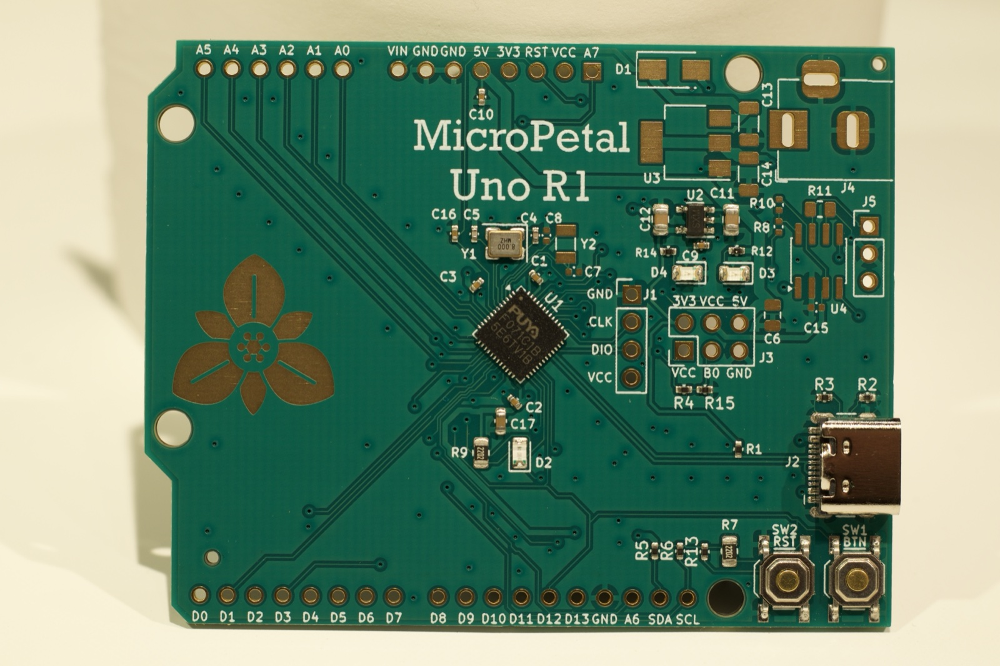

# MicroPetal Uno R1

[Get the MicroPetal Uno R1 Founders Edition at iMania](https://www.imania.dk/micropetal-uno-r1-founders-edition.htm).

Arduino Uno-format board accommodating PY32F071 and PY32F072. The initial assembly and software target is **PY32F071C1BU6**; F072 software support is not implemented yet.

## Hardware

KiCad sources and fabrication outputs are at the repository root and in `production/`.

## Software

The experimental Arduino core, PlatformIO platform, tools and examples live in [`software/`](software/README.md).

- [Arduino beginner guide](software/docs/ARDUINO-START.md)
- [PlatformIO beginner guide](software/docs/PLATFORMIO-START.md)
- [Schematic analysis and first-power instructions](software/docs/SCHEMATIC-ANALYSIS.md)

Software is compile-tested, not yet hardware-validated.

Run software commands from `software/`, e.g. `cd software` before following either guide.

## Getting a PCB

Prefer a ready-made board? [Get the MicroPetal Uno R1 Founders Edition at iMania](https://www.imania.dk/micropetal-uno-r1-founders-edition.htm). To manufacture your own, use the files in [`production/`](production/).
This project is kindly sponsored by JLCPCB. They offer cheap, professional looking PCBs and super fast delivery.

Step 1: Get the gerber file zip package from the /hardware folder
/hardware/rev2/rev2-1316.zip for instance.

Step 2: Upload to JLCPCB [https://jlcpcb.com](https://jlcpcb.com/?from=Anders_N)

Step 3: Pick your color, surface finish and order.

If you want JLCPCB to assemble a board, the BOM and placement files are also in the repo. 

You can use these affiliate links to get a board for $2 and also get $80 worth of New User Coupons at: https://jlcpcb.com/?from=Anders_N

And in case you also want to order a 3D-printed case you can use this link. 
How to Get a $7 3D Printing Coupon: https://jlc3dp.com/?from=Anders_N
